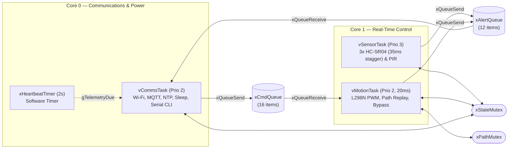

# RC Car Security Surveillance System (IoT Final Project)

An ESP32-based dual-node **RC Car Security Surveillance System** featuring FreeRTOS dual-core task scheduling, 3-way ultrasonic obstacle avoidance, PIR intruder detection, power-saving stationary mode, standalone ESP32-CAM MJPEG streaming with optional YOLOv8n person detection, and a unified Node-RED Dashboard 2.0 control center.

---

## Introduction

### Background & Problem Statement
Patrolling indoor or perimeter spaces manually requires continuous human presence, while static CCTV cameras suffer from blind spots. Combining a mobile 2WD RC platform with autonomous path replay, ultrasonic obstacle bypass, stationary PIR motion monitoring, and live MJPEG video streaming provides a flexible, low-cost security surveillance solution.

### System Overview
The system is divided into two cooperating microcontroller nodes and an optional host-side dashboard/vision pipeline:
1. **Main Controller (`ESP32 DevKit V1`):** Runs FreeRTOS tasks pinned across Core 0 (Wi-Fi, MQTT, NTP scheduler, power management) and Core 1 (sequential 3x HC-SR04 polling, PIR interrupt/monitoring, L298N PWM motor control, path recording/playback, and obstacle bypass).
2. **Vision Node (`AI-Thinker ESP32-CAM OV2640`):** Serves a dedicated MJPEG HTTP stream on port `81` (`/stream`) and control endpoints on port `80` (`/status`, `/capture`, `/flash`), with the onboard flash LED disabled by default.
3. **Control & Monitoring (`Node-RED Dashboard 2.0` + optional `YOLOv8n ONNX`):** Provides a D-Pad, mode selector (`MANUAL`, `AUTONOMOUS`, `STATIONARY`), path recording/playback controls, NTP patrol scheduling, ultrasonic gauges, live camera feed, and intruder alert popups.

### Hardware & Power Architecture
- **Main Controller:** ESP32 DevKit V1 (38-pin / DOIT DevKit V1)
- **Vision Node:** AI-Thinker ESP32-CAM (OV2640)
- **Drive & Chassis:** Sumo 2WD chassis (2x TT DC gear motors) + Mini L298N / MX1919 (`HW-856`) Dual DC Motor Driver *(also compatible with full-size L298N using `ENA`/`ENB`)*.
- **Sensors:**
  - 3x HC-SR04 Ultrasonic (Front, Left, Right — triggered sequentially with 35 ms stagger to prevent acoustic crosstalk; emergency stop/bypass at `< 20 cm`)
  - 1x HC-SR501 PIR Motion Sensor (connected to RTC-capable `GPIO 33` for interrupt & Light Sleep EXT0 wakeup)
- **Power System:** 2x 18650 Li-Ion in series (`7.4V` nominal / `8.4V` charged) → L298N motor input + 2x LM2596 `5.0V` buck converters (one dedicated to Main ESP32 + sensors, one dedicated to ESP32-CAM to prevent Wi-Fi/camera brownouts).

---

## Implementation

### Modular File Structure (4-Person Team Split)
```text
IoT-Final-Project/
├── platformio.ini              # Main ESP32 (esp32dev) PlatformIO build config
├── wokwi.toml                  # Wokwi simulator firmware pointer
├── include/
│   ├── config.h                # Shared 13-GPIO pinout, enums, structs, RTOS handles
│   ├── motion_control.h        # L298N PWM, path buffer, bypass API
│   ├── sensors_cam.h           # 3x HC-SR04 & HC-SR501 PIR API
│   ├── comms_ui.h              # Wi-Fi, MQTT, NTP, Power & Serial CLI API
│   └── secrets.h.example       # Wi-Fi/MQTT credentials template
├── src/
│   ├── main.cpp                # FreeRTOS initialization & Core 0/1 task pinning
│   ├── motion_control.cpp      # Drive control, path record/replay, obstacle bypass
│   ├── sensors_cam.cpp         # Staggered ultrasonic polling & PIR monitoring
│   └── comms_ui.cpp            # Non-blocking MQTT/Wi-Fi, NTP scheduler, Sleep
├── firmware_cam/               # Standalone ESP32-CAM MJPEG streaming firmware
├── nodered/
│   ├── flow.json               # Full Node-RED Dashboard 2.0 control & surveillance flow
│   └── vision_flow.json        # Standalone Vision-only Dashboard 2.0 flow
├── vision/                     # Optional ONNX Runtime YOLOv8n person detector
└── wokwi/
    └── diagram.json            # Wokwi circuit (4 LEDs, 3x HC-SR04, 1x PIR)
```

### Shared 13-GPIO Pinout
All pins avoid ESP32 flash pins (`GPIO 6–11`) and boot-strapping pins (`GPIO 0, 2, 5, 12, 15`), while input-only pins (`GPIO 34, 35`) are used exclusively for HC-SR04 `ECHO` inputs.

| Subsystem | Signal | ESP32 GPIO | Direction / Notes |
| :--- | :--- | :---: | :--- |
| **Motor Driver (`HW-856` / MX1919)** | `IN1` (`MOTOR-A` Fwd) | `26` | Output (Wokwi Green LED) |
| | `IN2` (`MOTOR-A` Rev) | `27` | Output (Wokwi Red LED) |
| | `IN3` (`MOTOR-B` Fwd) | `14` | Output (Wokwi Blue LED) |
| | `IN4` (`MOTOR-B` Rev) | `13` | Output (Wokwi Yellow LED) |
| | `GND` *(yellow header)* | `GND` | Common ground with ESP32 |
| **Full-size L298N *(optional)*** | `ENA` / `ENB` (PWM) | `25` / `32` | Leave unconnected on `HW-856` (no ENA/ENB pins) |
| **HC-SR04 Front** | `TRIG` / `ECHO` | `18` / `34` | Out / Input-only *(use 1kΩ+2kΩ divider on 5V hardware)* |
| **HC-SR04 Left** | `TRIG` / `ECHO` | `19` / `35` | Out / Input-only *(use 1kΩ+2kΩ divider on 5V hardware)* |
| **HC-SR04 Right** | `TRIG` / `ECHO` | `21` / `22` | Out / Input *(use 1kΩ+2kΩ divider on 5V hardware)* |
| **HC-SR501 PIR** | `OUT` | `33` | Input (`RTC_GPIO8`, RISING ISR + EXT0 wakeup) |

> **Power Wiring (`HW-856`):** Connect the 2S 18650 battery (`7.4V–8.4V`) to the blue 2-pin screw terminal (`+` top, `-`/`GND` bottom), `MOTOR-A` to the left DC motor, and `MOTOR-B` to the right DC motor. The **ESP32-CAM** is standalone and only connects to its own dedicated `5.0V` LM2596 buck converter.

### FreeRTOS Dual-Core Architecture


### Mapping to IoT Practicum Modules
| Module | Topic | Implementation in Project |
| :--- | :--- | :--- |
| **Module 1–2** | RTOS & Dual-Core Task Scheduling | `xTaskCreatePinnedToCore` across Core 0 (`vCommsTask`) and Core 1 (`vSensorTask`, `vMotionTask`), `vTaskDelayUntil` |
| **Module 3** | Memory Management & Queues | `xCmdQueue`, `xAlertQueue` passing fixed-size structs (`ControlCommand`, `AlertEvent`) without heap fragmentation |
| **Module 4** | Synchronization & Deadlock Prevention | `xStateMutex` and `xPathMutex` with strict lock-ordering discipline |
| **Module 5** | Software Timers & Hardware Interrupts | `xHeartbeatTimer` (`xTimerCreate`) for telemetry cadence + `IRAM_ATTR pirISR()` (`RISING` edge) |
| **Module 7** | Wi-Fi, HTTP & MQTT | Non-blocking `WiFi.h` + `PubSubClient` + `ArduinoJson` on Main ESP32; HTTP MJPEG/REST on ESP32-CAM |
| **Module 8** | Power Management | `STATIONARY` mode enables Wi-Fi Modem Sleep + 80 MHz CPU downclocking and supports ESP32 Light Sleep (`EXT0` PIR + Timer wakeup) |
| **Module 9** | IoT Platform (Node-RED) | FlowFuse Dashboard 2.0 (`nodered/flow.json`) with D-Pad, gauges, path controls, NTP scheduler, MJPEG stream, and alert popups |

### MQTT Topics (`broker.hivemq.com:1883`)
| Direction | Topic | Payload |
| :--- | :--- | :--- |
| Subscribe | `iot_finpro_naputriz/rc/cmd/move` | `FORWARD`, `BACKWARD`, `LEFT`, `RIGHT`, `STOP` |
| Subscribe | `iot_finpro_naputriz/rc/cmd/mode` | `MANUAL`, `AUTONOMOUS`, `STATIONARY` |
| Subscribe | `iot_finpro_naputriz/rc/cmd/speed` | `0`–`255` (PWM duty cycle) |
| Subscribe | `iot_finpro_naputriz/rc/cmd/path` | `REC_START`, `REC_STOP`, `PLAY`, `PAUSE`, `CLEAR`, `LOOP`, `DEMO` |
| Subscribe | `iot_finpro_naputriz/rc/cmd/schedule` | `{"enabled":true,"time":"HH:MM","loop":false}` or `"OFF"` |
| Subscribe | `iot_finpro_naputriz/rc/cmd/sleep` | `LIGHT_SLEEP` |
| Publish | `iot_finpro_naputriz/rc/telemetry` | JSON (`mode`, `dir`, `front_cm`, `left_cm`, `right_cm`, `step_rem_ms`, `ntp_time`, `cpu_mhz`, …) |
| Publish | `iot_finpro_naputriz/rc/alert/pir` | JSON (`event: "pir_motion"`, `message`, `timestamp_ms`) |
| Publish | `iot_finpro_naputriz/rc/alert/system` | JSON (`event: "obstacle" / "patrol_start" / "patrol_done" / "sleep_wake"`) |
| Publish *(Vision)* | `iot_finpro_naputriz/rc/alert/person` | JSON (`event: "person_detected"`, `count`, `max_confidence`) |

---

## Testing and Evaluation

### 1. Build Verification (PlatformIO)
```bash
# Main Controller (ESP32 DevKit V1)
pio run

# Vision Node (ESP32-CAM)
cd firmware_cam
pio run
```

### 2. Wokwi Simulation Test Scenarios
Open the project in VS Code with the **Wokwi Simulator** extension (`wokwi.toml` + `wokwi/diagram.json`), start the simulation, and test via **Node-RED** (`http://localhost:1880/dashboard/rc-surveillance`) or the **Serial Monitor** (`115200` baud):
- **Manual Drive & Path Recording:** Press `1` (`MANUAL`), `R` (start recording), `W`/`A`/`D`/`X` (or D-Pad), `T` (stop recording). Observe LEDs on GPIOs `26, 27, 14, 13`.
- **Manual Obstacle Emergency Stop:** While driving `FORWARD` (`W`), set `us_front` distance `< 20 cm` in Wokwi. Motors immediately stop and an `obstacle` alert is published.
- **Autonomous Replay & Obstacle Bypass:** Press `L` (load demo path) or use recorded path, then press `P` (`PLAY`). Set `us_front < 20 cm` mid-step: playback pauses preserving `stepRemainingMs`, executes the 6-phase bypass (`BRAKE → REVERSE → TURN_OUT → CLEAR_FWD → TURN_IN → SETTLE`), and resumes the interrupted step.
- **Stationary Mode, PIR & Power Saving:** Press `3` (`STATIONARY`). Motors disable, CPU drops to `80 MHz` with Wi-Fi Modem Sleep. Trigger **Simulate Motion** on `pir1` to receive an instant `pir_motion` alert popup in Node-RED. Press `Z` (or click **Trigger Light Sleep** in Node-RED) to test `EXT0` PIR wakeup from Light Sleep.

### 3. Node-RED Dashboard 2.0 & Vision Setup
1. Import [`nodered/flow.json`](nodered/flow.json) into Node-RED with `@flowfuse/node-red-dashboard` installed, click **Deploy**, and open `http://localhost:1880/dashboard/rc-surveillance`.
2. *(Optional)* Run `python vision/person_detector.py` (see [`vision/README.md`](vision/README.md)) for YOLOv8n-annotated MJPEG streaming on `http://localhost:5000/stream`.

---

## Conclusion
The RC Car Security Surveillance System successfully integrates FreeRTOS dual-core real-time scheduling, multi-sensor obstacle avoidance, non-blocking path recording and autonomous replay, power-efficient stationary PIR surveillance, live ESP32-CAM MJPEG streaming, and Node-RED Dashboard 2.0 telemetry/control while remaining fully testable in both Wokwi simulation and physical hardware.

---

## References
1. Espressif Systems, *ESP32 Technical Reference Manual & ESP-IDF Sleep Modes Documentation*.
2. FreeRTOS Official Documentation — *Tasks, Queues, Mutexes, Software Timers*.
3. Laboratorium DTE FTUI, *Modul 1–10 Praktikum Internet of Things (IoT)*.
4. FlowFuse, *Node-RED Dashboard 2.0 (`@flowfuse/node-red-dashboard`) Documentation*.
5. Knolleary, *PubSubClient MQTT Library*; Benoît Blanchon, *ArduinoJson v7*.
